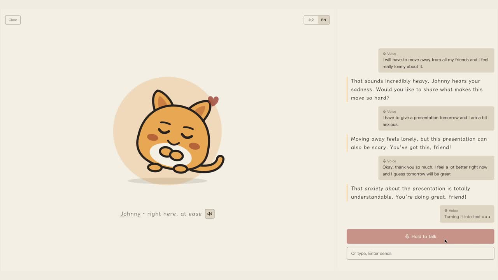

# Little Buddy — an offline voice companion

**Talk about your feelings out loud, with Wi‑Fi off. Nothing leaves your Mac.**

Little Buddy is a local web page with a cartoon companion. You hold a button and speak.
[WhisperKit](https://github.com/argmaxinc/WhisperKit) (Argmax) turns your voice into text on-device,
**Bonsai 2 9B** writes a short, warm reply and judges your mood, and the companion's face follows
that mood. Argmax TTSKit then reads the reply aloud. Every step runs on your Mac, with no cloud and no API keys.

Built solo for the Cornell Local AI Hackathon (November 2026).

## Demo
[](docs/demo/little-buddy.mp4)

▶ **[Watch the 86-second demo](docs/demo/little-buddy.mp4)**. Everything in it was recorded with Wi‑Fi off.

## Why local AI
Feelings are the most private data there is. Most AI companions send every word to a server, where it is stored,
logged, reviewed or used for training. Little Buddy takes a different approach:

- **Your words never leave your Mac.** Speech recognition, the language model, mood detection and the voice all run on-device.
  The gateway listens on `127.0.0.1` only, the page makes no external requests, and there are no accounts, analytics or API keys.
- **Works with no connection at all.** Turn Wi‑Fi off and it still works: on a plane, in a dorm with bad Wi‑Fi, or late at night
  when you simply don't want anything online. A hard moment shouldn't depend on a signal bar.
- **Nothing is kept.** Clear the conversation with one tap. The server keeps no transcript, and the logs record events and timings, never what you said.
- **Safer to open up.** People share more honestly when they know no one else is listening. Privacy is the point of the product, not an extra.
- **Free and always available.** No subscription and no rate limits. It runs on hardware you already own.

## What it does
- **Voice in, voice out:** hold to talk (or type). The reply is read aloud in the serena voice; you can mute it, and talking again stops it.
- **The face follows your mood:** five moods (pleasant/unpleasant × high/low energy, plus neutral) drive the companion's expression and colour.
- **English and Chinese:** the reply follows the language you speak; the interface switches between EN and 中文.
- **Breathe together:** when you sound anxious, it offers a short guided breath (in 4 s, out 6 s, three rounds).
- **Gentle safety net:** if a message suggests self-harm or suicide, the reply gently names a crisis helpline and a calm card shows who to call.
  The numbers follow **where you are**, not the language you chat in. The region is read from your Mac's region setting (then its time zone), on device, never from the network:
  mainland China → 12356 (national mental health helpline), 110 / 120 for immediate danger; US → 988 (call or text), 911; anywhere else → findahelpline.com and your local emergency number.
  Set `COMPANION_REGION=CN`, `US` or `OTHER` to override it; `npm start` prints the region it uses.
  Detection is semantic first (Bonsai judges the meaning, at temperature 0), with unambiguous phrases as a floor and the full phrase list as a fallback if the model is unavailable.
- **Yours:** give it a name, poke it, and clear the whole conversation in one tap. Nothing is stored on a server.

> Little Buddy is a companion, not a therapist or a medical device. It makes no health claims.

## How it works
```
Mic ─▶ WhisperKit (large-v3, Core ML) ─▶ Node gateway ─▶ Bonsai 2 9B (llama-server)
                                              │            ├─ reply (≤ 2 sentences)
                                              │            └─ mood + risk (JSON, temperature 0)
Page ◀── reply + mood + crisis flag ──────────┘
Page ──▶ /api/speak ──▶ TTSKit (Qwen3-TTS, voice serena) ──▶ audio
```
- `server/`: Node gateway on `127.0.0.1:4317`. It supervises the three local helpers and serves the page.
- `stt/`: Swift helpers for speech-to-text (WhisperKit) and read-aloud (TTSKit).
- `web/`: the page in plain HTML, CSS and JS, with no build step and no external requests.
- Everything binds to loopback only, and the page loads no remote fonts or scripts.

## Run it
Requirements: an Apple Silicon Mac (macOS 15), Node 22 or later, Xcode command-line tools (Swift), and enough free memory for Bonsai 9B plus Whisper large-v3.
Download the models first (Bonsai GGUF + llama-server, WhisperKit large-v3, Qwen3-TTS) to the paths listed in `server/config.js`.

```bash
npm run setup     # one time: builds the Swift helpers and warms up the models
npm start         # then turn Wi‑Fi off and open http://127.0.0.1:4317
```
If a model is missing, `npm start` prints the path it expects.
If read-aloud files are missing, chat still works without voice.

## Tests
```bash
npm test          # frontend and backend suites (the live suites expect a running instance)
```
More than 300 automated tests cover the moods, language, crisis rule, read-aloud queue and page behaviour.

## License
Little Buddy is licensed under the [Apache License 2.0](LICENSE). Third-party components and the models it downloads keep their own licences; see [NOTICE](NOTICE).
